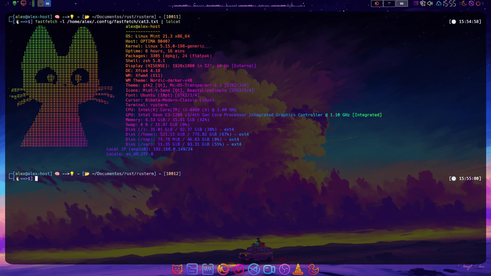

# Rusterm


**Rusterm** es un emulador de terminal moderno escrito en Rust, renderizado por GPU con transparencia, esquinas redondeadas y parpadeo de cursor. Combina el parseo ANSI/VT probado de `alacritty_terminal` con una ventana propia basada en `winit` y un renderizador de texto GPU construido sobre `wgpu` + `glyphon`.

## Capturas



## Características

- **Renderizado por GPU** con `wgpu` (backends Vulkan y OpenGL, con fallback automático).
- **Transparencia y esquinas redondeadas** mediante un shader WGSL propio.
- **Parpadeo de cursor** (500 ms) con redibujado bajo demanda: el bucle de eventos alterna entre `Wait` y `Poll` para no consumir CPU cuando está inactivo.
- **Renderizado de texto con `glyphon`** (cosmic-text): familias de fuentes configurables, soporte de glifos anchos/emoji y colores ANSI de 16/256/truecolor con paleta estilo Nord.
- **Caché por fila**: solo se recomponen las filas cuyo contenido cambió entre fotogramas.
- **PTY nativa** con `portable-pty` e hilo lector con buffer de 64 KB y canal `crossbeam` hacia el bucle de eventos.
- **Compatibilidad VT/ANSI** completa gracias a `alacritty_terminal` (incluido modo cursor de aplicación).
- **Configuración en TOML** (`rusterm.conf`), autogenerada con valores por defecto en el primer arranque.
- **Ventana sin decoraciones** del sistema (borderless), centrada en el monitor principal.

## Requisitos

- **Rust** 1.70+ (edición 2021) — [rustup.rs](https://rustup.rs)
- **Linux** con X11 o Wayland
- Dependencias del sistema para `wgpu`/`winit`:
  - Vulkan drivers (Mesa/RADV o equivalentes) **o** drivers OpenGL
  - En Wayland: librerías de desarrollo de Wayland (`wayland-client`, `libxkbcommon`)
  - En X11: `libx11`, `libxcursor`, `libxrandr`, `libxi`

Ejemplo en Arch Linux:

```bash
sudo pacman -S --needed vulkan-icd-loader mesa libxkbcommon wayland
```

Ejemplo en Debian/Ubuntu:

```bash
sudo apt install build-essential pkg-config libwayland-dev libxkbcommon-dev mesa-vulkan-drivers
```

## Compilación

```bash
# Depuración
cargo build

# Producción (recomendado)
cargo build --release

# Ejecutar
cargo run --release
```

El binario queda en `target/release/rusterm`.

## Uso

```bash
./target/release/rusterm
```

Rusterm lee `rusterm.conf` del directorio de trabajo actual. Si no existe, lo crea con los valores por defecto.

### Atajos de teclado

| Tecla | Acción |
|---|---|
| `Enter`, `Backspace`, `Tab`, `Escape` | Teclas de control estándar |
| `Flechas` | Navegación (respeta el modo cursor de aplicación: `CSI`/`SS3`) |
| `Home` / `End` | Inicio / Fin de línea |
| `Insert` / `Delete` | Insertar / Borrar |
| `PageUp` / `PageDown` | Paginación |
| `Ctrl` + `C` | `SIGINT` (`^C`) |
| `Ctrl` + `D` | Cierra la ventana de Rusterm |
| `Ctrl` + `L` | `^L` (limpiar pantalla) |

## Configuración

Archivo `rusterm.conf` (formato TOML):

```toml
background_opacity = 0.7        # Opacidad del fondo (0.0 - 1.0)
window_decorations = false       # Decoraciones de la ventana del sistema
rounded_corners = true           # Esquinas redondeadas en el fondo
font_size = 16.0                 # Tamaño de fuente en píxeles lógicos
font_family = "Hack Nerd Font Mono"  # Familia de fuentes (o "monospace")
cursor_blink = true              # Parpadeo del cursor
scrollback_lines = 10000         # Líneas de historial
shell = "/usr/bin/zsh"           # Shell a ejecutar (por defecto: $SHELL)
```

| Opción | Tipo | Por defecto | Descripción |
|---|---|---|---|
| `background_opacity` | `f32` | `0.7` | Opacidad del fondo de la ventana |
| `window_decorations` | `bool` | `false` | Decoraciones nativas de la ventana |
| `rounded_corners` | `bool` | `true` | Esquinas redondeadas del fondo |
| `font_size` | `f32` | `16.0` | Tamaño de fuente |
| `font_family` | `String` | `"Hack Nerd Font Mono"` | Familia; los nombres genéricos (`monospace`, `serif`, `sans-serif`, `cursive`, `fantasy`) se resuelven a la familia del sistema para mantener la rejilla alineada |
| `cursor_blink` | `bool` | `true` | Parpadeo del cursor |
| `scrollback_lines` | `usize` | `10000` | Líneas de scrollback |
| `shell` | `String` | `$SHELL` o `bash` | Shell ejecutada en la PTY |

> **Nota de versiones:** en 0.1.0 la opacidad y las esquinas redondeadas se aplican con valores fijos en el shader (`0.7` / radio `0.02`), el parpadeo siempre está activo y el scrollback usa el valor por defecto de `alacritty_terminal` (10000 líneas). Ver [CHANGELOG](CHANGELOG.md) y la sección *Limitaciones*.

## Arquitectura

```
src/
├── main.rs        # Bucle de eventos (winit), entrada de teclado → secuencias ANSI
├── config.rs      # Carga/guardado de rusterm.conf (serde + toml)
├── pty.rs         # PTY nativa, hilo lector y canal hacia el bucle de eventos
├── terminal.rs    # Rejilla y parser VT/ANSI sobre alacritty_terminal
├── renderer.rs    # Pipeline wgpu, atlas de texto glyphon y caché por fila
└── shader.wgsl    # Fondo: transparencia + esquinas redondeadas
```

Flujo de datos:

```
teclado ──key_to_ansi()──► PTY (portable-pty) ──shell──┐
                                                       ▼
render ◄── glyphon/atlas ◄── grid ◄── Processor(VT) ◄── hilo lector (64 KB)
  │
  └──► wgpu (shader de fondo + texto) ──► ventana winit
```

1. `main.rs` traduce las teclas a secuencias ANSI y las escribe en la PTY.
2. Un hilo dedicado lee la salida del shell y la envía por un canal `crossbeam`.
3. En cada `RedrawRequested` se consumen los datos pendientes y se procesan con `alacritty_terminal`.
4. `renderer.rs` compone solo las filas modificadas (caché por clave de contenido) y dibuja fondo + texto en una sola pasada de render.

## Dependencias principales

| Crate | Versión | Uso |
|---|---|---|
| [`winit`](https://crates.io/crates/winit) | 0.29 | Ventana y bucle de eventos |
| [`wgpu`](https://crates.io/crates/wgpu) | 22.1 | Renderizado gráfico multiplataforma |
| [`glyphon`](https://crates.io/crates/glyphon) | 0.6 | Texto GPU (cosmic-text) |
| [`alacritty_terminal`](https://crates.io/crates/alacritty_terminal) | 0.26 | Parser VT/ANSI y rejilla |
| [`portable-pty`](https://crates.io/crates/portable-pty) | 0.8 | PTY multiplataforma |
| [`crossbeam-channel`](https://crates.io/crates/crossbeam-channel) | 0.5 | Comunicación hilo PTY → UI |
| [`serde`](https://crates.io/crates/serde) / [`toml`](https://crates.io/crates/toml) | 1.0 / 0.8 | Configuración |
| [`pollster`](https://crates.io/crates/pollster) | 0.3 | Bloqueo síncrono de la init async de wgpu |
| [`env_logger`](https://crates.io/crates/env_logger) / [`log`](https://crates.io/crates/log) | 0.11 / 0.4 | Logs (`RUST_LOG=debug`) |

## Limitaciones conocidas (0.1.0)

- `background_opacity` y `rounded_corners` todavía no se aplican desde la configuración (valores fijos en el shader).
- `cursor_blink` y `scrollback_lines` se leen pero no alteran el comportamiento todavía.
- Sin scroll con el ratón ni selección/copiado de texto.
- Sin pestañas, split ni búsqueda.
- Atajos `Ctrl` limitados (`C`, `D`, `L`).
- Dirigido a Linux (X11/Wayland); no probado en otras plataformas.

## Contribuir

¡Las contribuciones son bienvenidas! Lee [CONTRIBUTING.md](CONTRIBUTING.md) para el flujo de trabajo, el estilo de código y cómo reportar issues.

## Licencia

Distribuido bajo la licencia [MIT](LICENSE).
